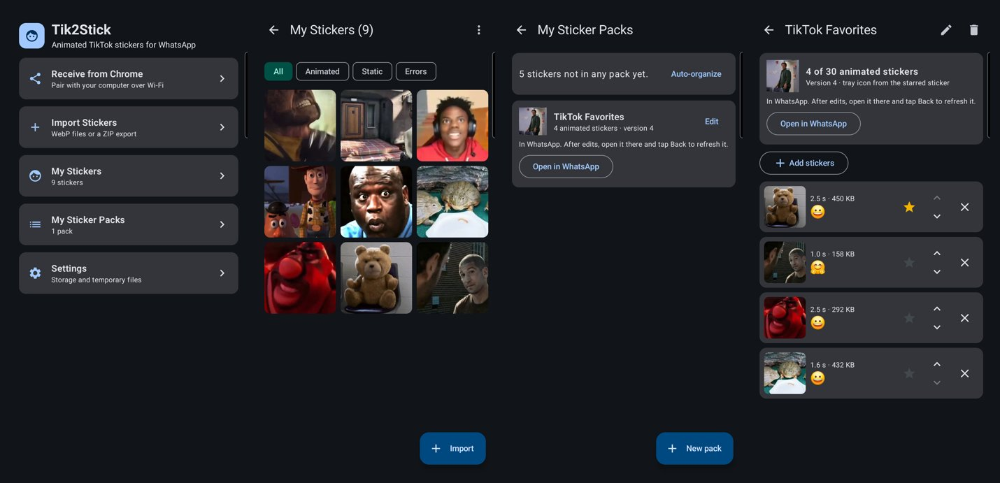
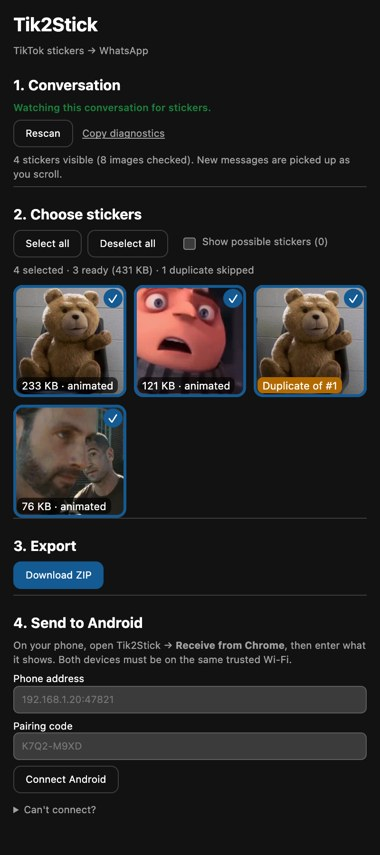
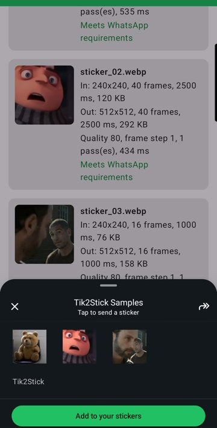
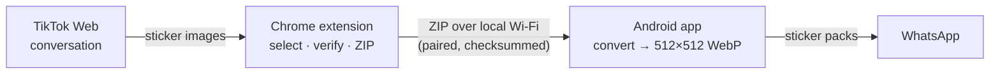

# Hey, I'm Alan Acevedo

<!-- Optional: one or two lines about you, e.g. what you study or work on, what you're looking for, and how to reach you. -->

## Featured project: Tik2Stick

**Move animated stickers from TikTok conversations into WhatsApp, still animated.** A Chrome extension
collects the stickers, local Wi-Fi carries them, and a native Android app converts them and installs them as
WhatsApp sticker packs. No cloud, no paid services, no third-party sticker-maker app.

<table>
<tr>
<td></td>
<td></td>
<td>

**Chrome side panel.** Scans the TikTok conversation you open, previews the animated stickers, flags
duplicates, and exports a ZIP or sends it to the phone.

**WhatsApp.** Packs are installed through WhatsApp's official sticker-pack flow and animate when sent.

</td>
</tr>
</table>

### What I built

- **Native image pipeline (C, libwebp, JNI).**
  - Decodes TikTok's 240×240 animated WebP frame by frame.
  - Rescales with correct transparency handling into WhatsApp's 512×512 format, keeping the original timing.
  - Re-encodes, lowering quality step by step (and frame rate only as a last resort) to fit the 500 KB limit.
- **Android app (Kotlin, Jetpack Compose, Room).**
  - Imports from the file picker, the share sheet or Wi-Fi, with SHA-256 de-duplication.
  - Converts in parallel, with cancellation.
  - Sticker library with animated previews.
  - Packs: automatic splitting into 3–30 stickers per pack, and WhatsApp's ContentProvider integration.
- **Secure local Wi-Fi transfer.**
  - A dependency-free HTTP/1.1 receiver that runs only while its screen is open.
  - One-time pairing code with lockout, plus "Allow this computer?" approval on the phone.
  - Expiring 256-bit session tokens.
  - Origin and Host checks, and checksum-verified streaming uploads.
- **Chrome extension (TypeScript, Manifest V3).**
  - A side panel that reads only the conversation you open.
  - Several detection signals, so it survives markup changes.
  - Downloads without your login cookies; every file is verified as WebP before use.

### Results

- **65 stickers** from Chrome to the phone and imported in **≈14 s**, auto-split into packs of 22 / 22 / 21.
- **109 end-to-end transfers, 0 failures**, including duplicate re-sends and transfers interrupted on either
  side.
- **130+ automated tests**:
  - native converter (CTest);
  - Android unit tests and on-device tests;
  - extension unit tests;
  - a harness that drives the real extension in Chrome and sends to a real phone.
- CI on GitHub Actions for every push.

### How it works

### Tech

-4285F4?logo=googlechrome&logoColor=white>)

The Tik2Stick repository is private, and for personal
use only; not affiliated with TikTok or WhatsApp.
