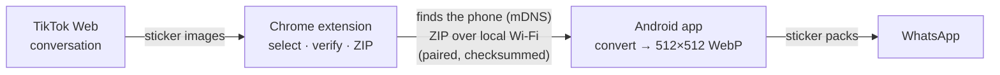
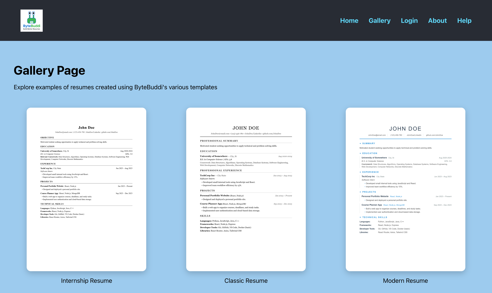
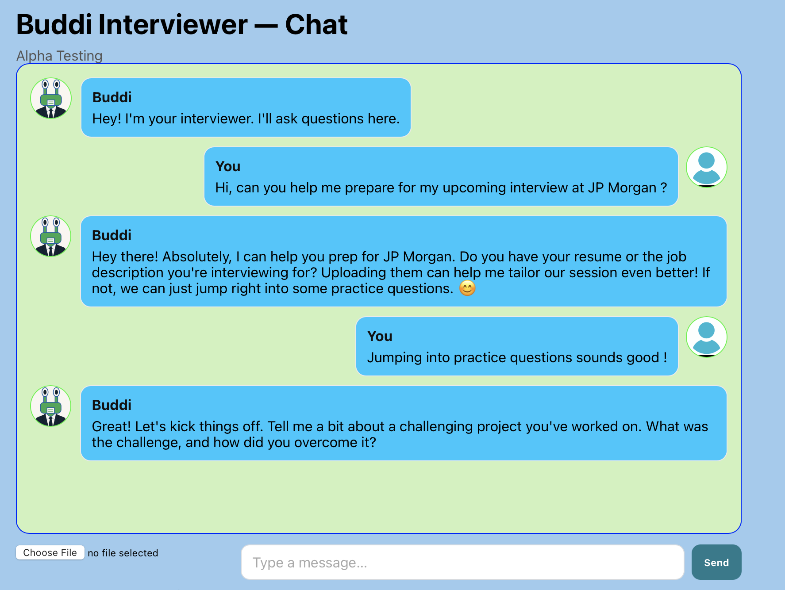
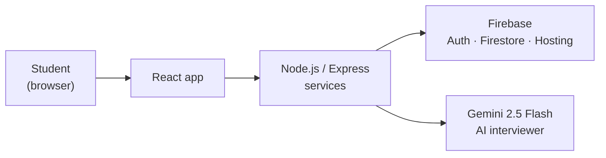
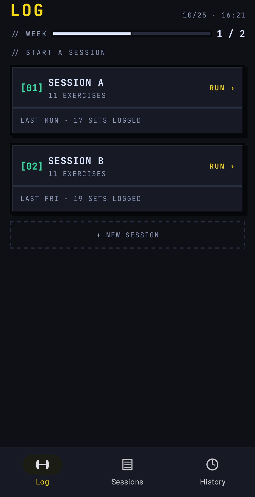
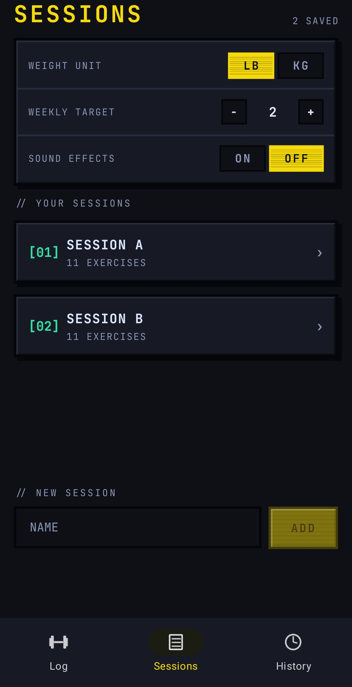
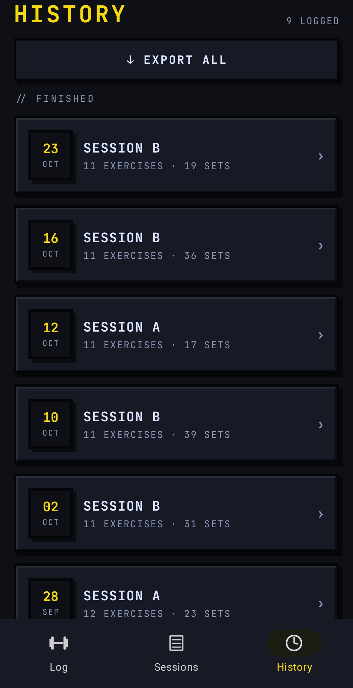
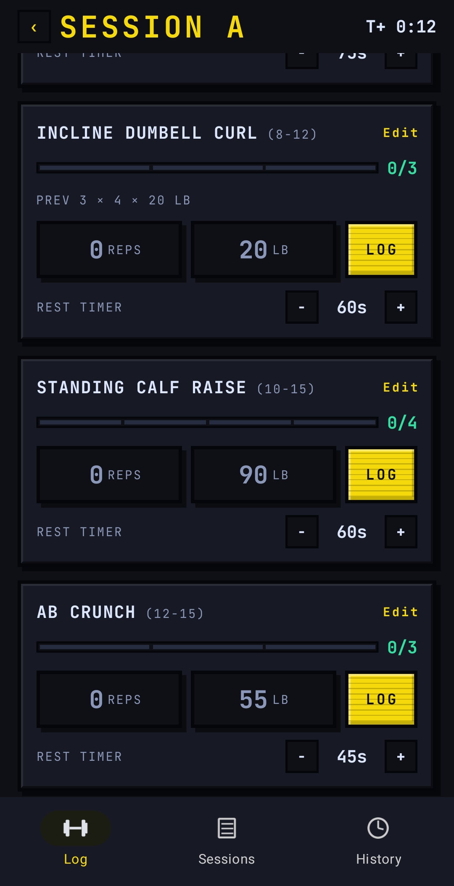

# Hey, I'm Alan Acevedo

I'm a Computer Science student at **UT Arlington** (B.S. with a Cyber Security Certificate, graduating
December 2026, 3.83 GPA) and I'm **CompTIA Security+** certified. I'm interested in cybersecurity and
software engineering, and I like building tools for problems I actually have. The projects below are apps
I use myself, built with the help of AI coding assistants.

**Looking for:** entry-level cybersecurity or software roles starting January 2027, in the DFW area or
anywhere I can relocate. I'm fluent in English and Spanish.

[LinkedIn](https://www.linkedin.com/in/alanacevedoo) · [alanacevedohdz@gmail.com](mailto:alanacevedohdz@gmail.com)

## Featured project: Tik2Stick

**Move animated stickers from TikTok conversations into WhatsApp, still animated.** A Chrome extension
collects the stickers, local Wi-Fi carries them, and a native Android app converts them and installs them as
WhatsApp sticker packs. No cloud, no paid services, no third-party sticker-maker app.

<table>
<tr>
<td></td>
<td></td>
<td>

**Chrome side panel.** Scans the TikTok conversation you open, previews the animated stickers, flags
duplicates, and exports a ZIP or finds the phone on your Wi-Fi and sends the stickers there.

**WhatsApp.** Packs are installed through WhatsApp's official sticker-pack flow and animate when sent.

</td>
</tr>
</table>

### What I built

- **Native image pipeline (C, libwebp, JNI).**
  - Decodes TikTok's 240×240 animated WebP frame by frame.
  - Rescales with correct transparency handling into WhatsApp's 512×512 format, keeping the original timing.
  - Re-encodes, lowering quality step by step (and frame rate only as a last resort) to fit the 500 KB limit.
- **Android app (Kotlin, Jetpack Compose, Room).**
  - Imports from the file picker, the share sheet or Wi-Fi, with SHA-256 de-duplication.
  - Converts in parallel, with cancellation.
  - Sticker library with animated previews.
  - Packs: automatic splitting into 3–30 stickers per pack, and WhatsApp's ContentProvider integration.
- **Secure local Wi-Fi transfer.**
  - **Automatic device discovery:** the extension's **Find Devices** locates the phone, with no IP address to
    type. Chrome extensions have no mDNS API, so the app answers mDNS for `tik2stick.local` (plus a standard
    DNS-SD service), which the operating system resolves for the browser.
  - A dependency-free HTTP/1.1 receiver that runs only while its screen is open.
  - One-time pairing code with lockout, plus "Allow this computer?" approval on the phone.
  - Expiring 256-bit session tokens.
  - Origin and Host checks, and checksum-verified streaming uploads.
- **Chrome extension (TypeScript, Manifest V3).**
  - A side panel that reads only the conversation you open.
  - Several detection signals, so it survives markup changes.
  - Downloads without your login cookies; every file is verified as WebP before use.

### Results

- **65 stickers** from Chrome to the phone and imported in **≈14 s**, auto-split into packs of 22 / 22 / 21.
- **109 end-to-end transfers, 0 failures**, including duplicate re-sends and transfers interrupted on either
  side.
- **Automatic discovery verified on real devices (21/21 checks)**: found without typing an address, found
  again after the phone's receiver restarts or its Wi-Fi reconnects, and gone once the phone stops receiving.
- **145+ automated tests**:
  - native converter (CTest);
  - Android unit tests and on-device tests;
  - extension unit tests;
  - a harness that drives the real extension in Chrome and sends to a real phone.
- CI on GitHub Actions for every push.

### How it works

### Tech

-4285F4?logo=googlechrome&logoColor=white>)

The Tik2Stick repository is private, and for personal
use only; not affiliated with TikTok or WhatsApp.

 

---

 

## Featured project: ByteBuddi

**A free web platform where UTA students build resumes, check them against job postings, and practice
interviews with an AI chatbot.** Live at [bytebuddi.com](https://bytebuddi.com). Built as my Senior Design
project with a team of six, Fall 2025 to Spring 2026.

<table>
<tr>
<td align="center"> Resume template gallery</td>
<td align="center"> AI interviewer chat</td>
</tr>
</table>

### What the team built

- **Resume builder.** Live preview while you type, built-in templates, and PDF download.
- **ATS keyword checker.** Compares a resume to a job description and scores it for editing.
- **AI interviewer.** A chatbot that practices interview questions for engineering roles.
- **Accounts.** Login and authentication through Firebase.

### What I built

- **AI interviewer (Google Gemini 2.5 Flash API).** Integrated the Gemini API into the chatbot and wrote its
  prompts with role context, so it generates role-specific interview questions.
- **Home page front end (React).** Built the landing page shown above.
- Worked to the team's security requirements: OWASP practices, and no storage of users' chatbot conversations.

### How it works

### Tech

Senior Design project at the University of Texas at Arlington, built with a team of six.

 

---

 

## Featured project: WorkoutTracker

**A dark-themed workout logger for Android, with a custom native module so rest-timer notifications keep
ticking reliably in the background.** Built with Expo/React Native and a hand-written Kotlin module that
talks directly to Android's alarm and battery-optimization APIs.

 

<table>
<tr>
<td align="center"> Sessions & settings</td>
<td align="center"> History</td>
<td align="center"> Mid-workout, rest timers running</td>
</tr>
</table>

### What I built

- **Workout logging (TypeScript, Expo Router, AsyncStorage).**
  - Session-based log: exercises, sets, reps and weight, with kg/lb unit support.
  - Session history with per-session detail views.
  - Export a workout to a text file via the share sheet.
- **Native Android rest-timer module (Kotlin, Expo Modules API).**
  - A real OS-level chronometer notification that counts down to an end time independent of the JS
    thread, so it survives the app being backgrounded or killed.
  - Direct handling of Android's exact-alarm and battery-optimization restrictions (`AlarmManager`,
    `PowerManager`) — neither is granted automatically just because the manifest declares the permission.
  - One-tap deep links into the system's "Alarms & reminders" and "Ignore battery optimizations" screens.
  - An in-app reliability banner that surfaces when either setting would silently delay or drop a
    scheduled timer.
- **UI/UX.** Custom dark theme and JetBrains Mono typography, shake animation when a rest timer hits zero
  (Reanimated), haptics.

### Tech

The WorkoutTracker repository is private, and for personal use only.
